# Mermaid

## XY 图表

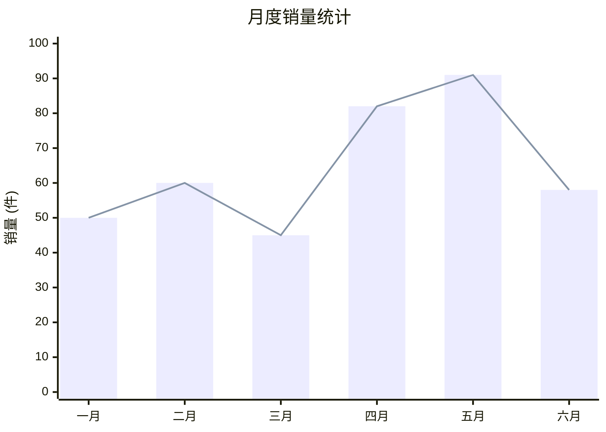

## 方块图

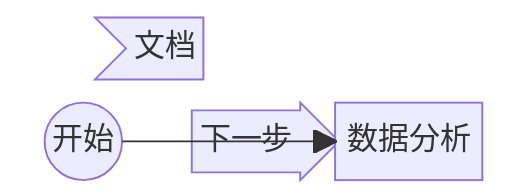

## 架构图 (C4 Diagram)

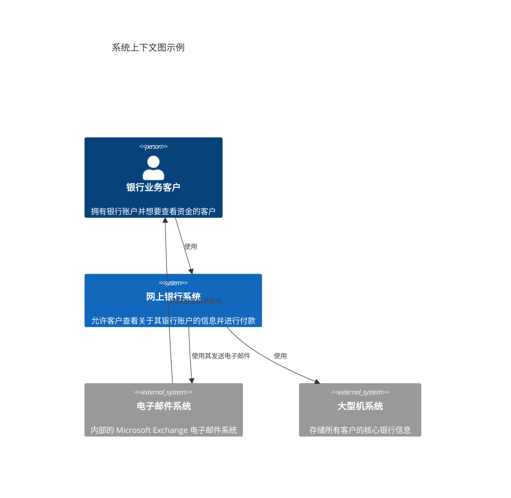

## 时间轴

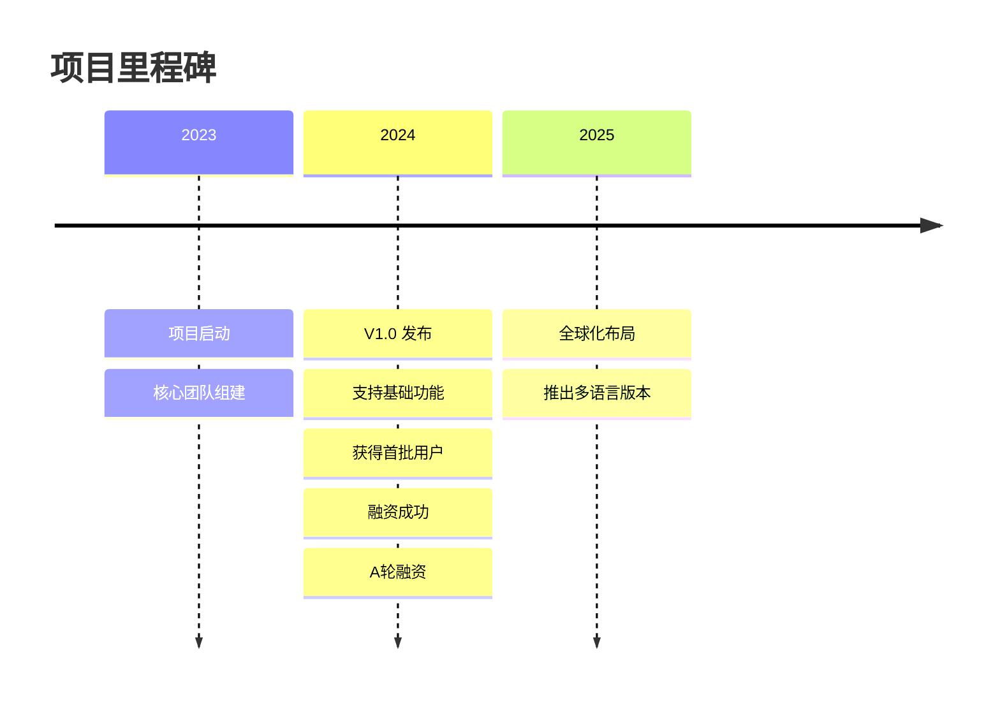

## 需求图

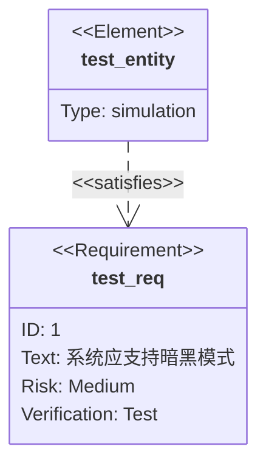

## 象限图

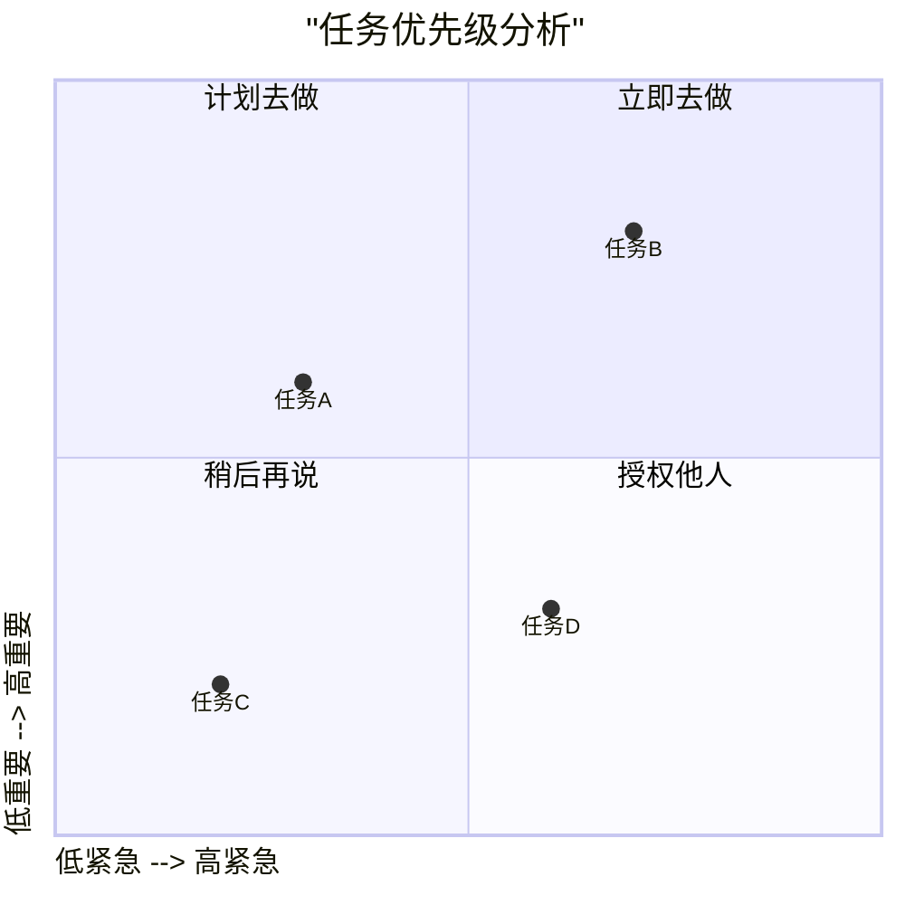

## 饼图进阶版

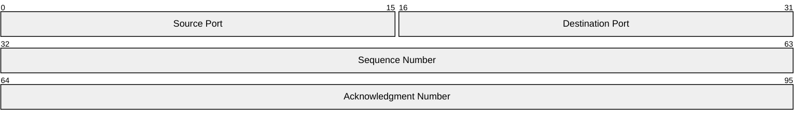

## 饼图

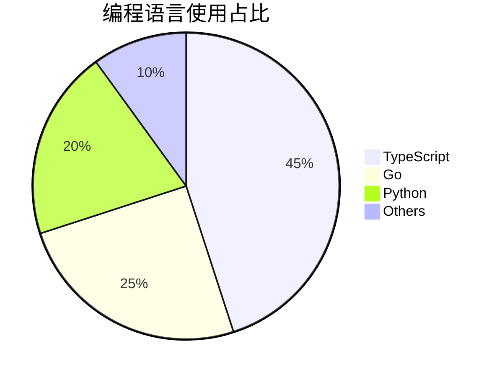

## 桑基图

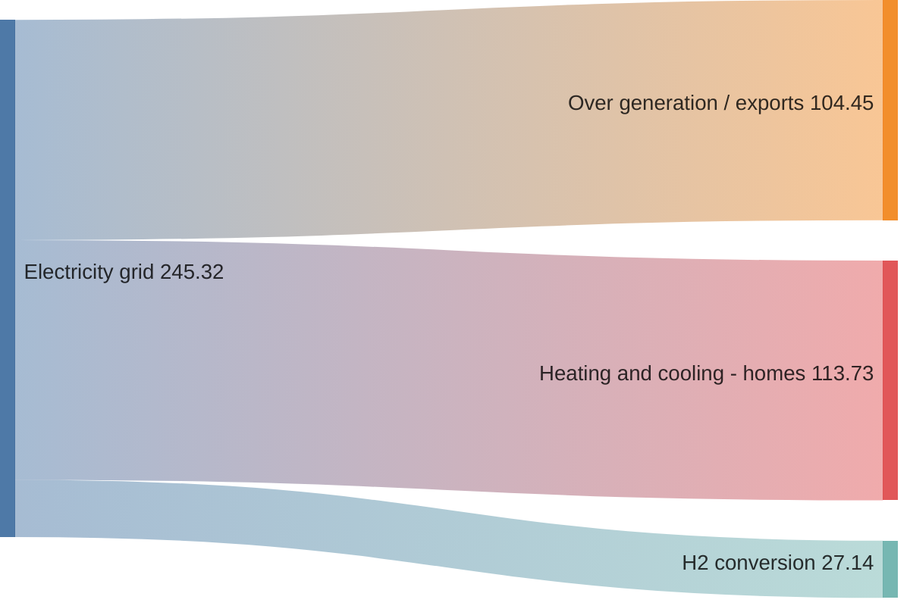

## 用户旅程图

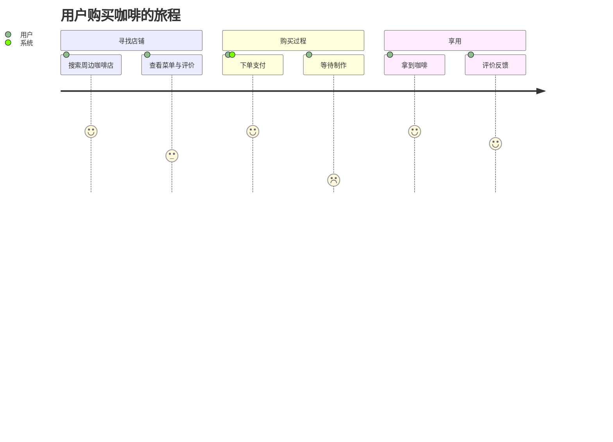

## Git 图

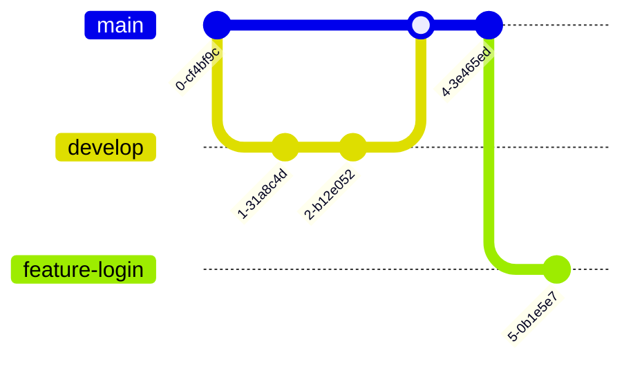

## 状态图

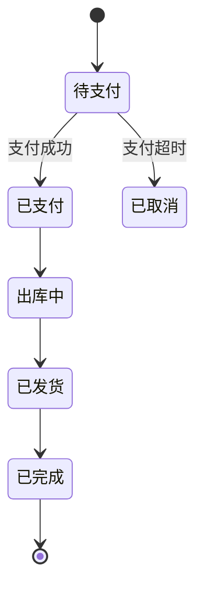

## 实体关系图

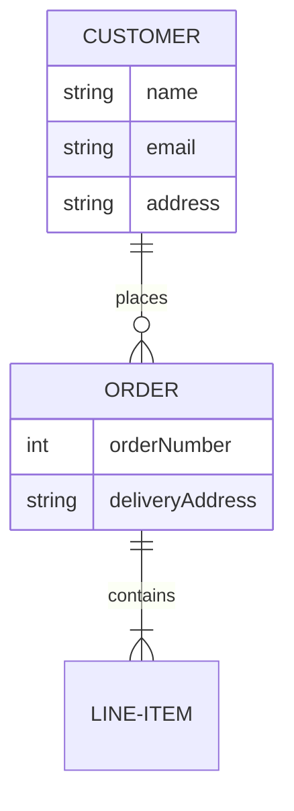

## 甘特图

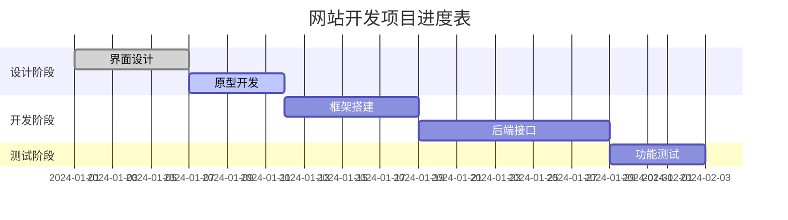

## 时序图

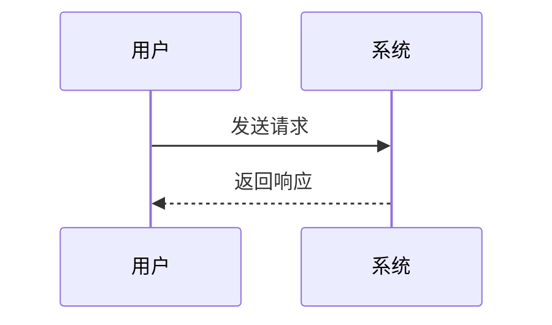

## 流程图

### 示例一

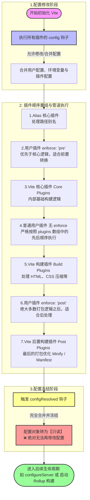

### 示例二

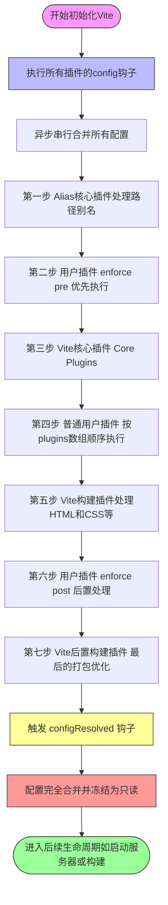

## Diagrams

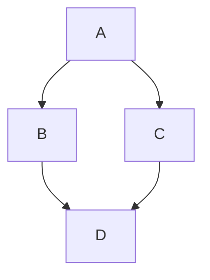
